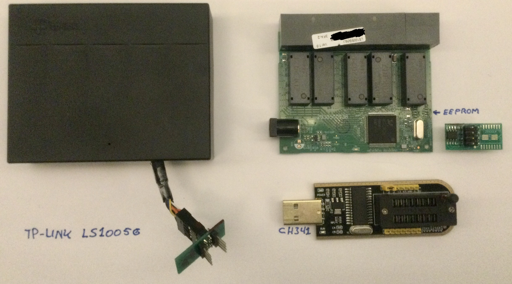

# Turning a €10 switch into a data diode — affordable cybersecurity for OT environments

In the world of cybersecurity, **data diodes** are often seen as the bank vaults of secure data
transfer—impenetrable, expensive, and complex. But what if you could achieve robust,
unidirectional data flow for around €10 using a common network switch? By tweaking the EEPROM
registers of an unmanaged switch with an **RTL8367S** chip, we can create a low-cost, one-way data
path suitable for operational technology (OT) environments and micro-segmentation. Sometimes, all
you need is a good lock, not a vault.

This page documents a **working** build: a full gigabit, one-way switch produced by appending a
handful of register writes to the stock EEPROM. It covers the EEPROM format, a decoded map of the
stock firmware, the exact bytes for a single diode and a double diode, and — importantly — an
honest account of what this device does and does **not** protect against.

## The approach

The RTL8367S handles Ethernet switching with a lot of internal flexibility. Its power-on
configuration lives in a small **24C02 EEPROM** that the chip reads on boot. By reading that EEPROM,
appending a few **port-isolation** register writes, and writing it back, we can tell the switch
fabric to forward frames in one direction only. Data can then move from a source (e.g. an OT sensor
or a SPAN port) to a destination (e.g. a monitoring system) while the reverse path is dropped — for
the price of a coffee.

## Redefining the data diode mindset

The biggest barrier to adopting data diodes is the misconception that they must be fortress-like
solutions reserved for defense or finance. In reality, many OT use cases don’t need a bank
vault—they need a **reliable lock**. A €10 data diode provides exactly that: a simple, effective way
to push data one way and shrink the attack surface, without unnecessary complexity.

## Important — what kind of diode is this?

Be clear-eyed about this before deploying it. There are two ways to enforce one-way flow:

- **Physical diode** — the return path does not exist in hardware (for example a fibre link with no
  transmit strand on the receive side). It **cannot** be turned back into a two-way link by
  reconfiguration.
- **Logical diode** — the return path exists in hardware but is disabled by configuration. This is
  what the €10 switch is: the switch fabric is told not to forward frames backwards, but the
  transceivers stay physically live.

**The RTL8367S firmware diode is a logical diode.** It runs at full gigabit and the one-way rule is
enforced in the switch fabric, but that rule only holds while the configuration stays intact. Treat
it as a **micro-segmentation and defense-in-depth** control — a strong, cheap lock — **not** a
certified cross-domain solution. Where the endpoints cannot be trusted at all and remote or physical
compromise is in scope, use a physical (fibre) diode. See *Limitations and threat model* below.

## How can we do it?

1. **Identify the switch** — an unmanaged switch with the RTL8367S chip, e.g. the **TP-Link
   LS1005G** (~€10).
2. **Access the EEPROM** — read the 24C02 with a **CH341A USB programmer** in
   [AsProgrammer](https://github.com/therealdreg/asprogrammer-dregmod)
   (`IC → I2C → 24Cxxx → 24C02`). You can flash in-place with a suitable clip, or lift the chip onto
   a breakout.
3. **Append the isolation writes** — add the port-isolation register writes that restrict forwarding
   to one direction (exact bytes below), and update the 2-byte read-length header so the loader
   reads them.
4. **Test and deploy** — verify one-way flow with a packet capture on the source-facing port (there
   should be **zero** egress toward the source) before deploying.

## Why this matters for OT and micro-segmentation

In OT environments—manufacturing plants, energy grids, water treatment—security is critical but
budgets are tight. Commercial diodes cost thousands. A €10 logical diode offers:

- **Micro-segmentation** — isolate OT devices so a sensor can send data to a central system without
  being reachable for commands, limiting lateral movement.
- **Affordable security** — protect critical infrastructure without the price tag, making basic
  segmentation accessible to smaller organisations.
- **Simplicity** — no proprietary hardware; a switch, a few register writes, and a clear use case.

## The experiment

We bought a €9.99 TP-Link LS1005G 5-port **gigabit** switch, read its 24C02 EEPROM over a CH341A,
and captured the stock image.

<br> <br>

**Full stock register image (including blank FF):**

```
00000000: 56 80 16 1D 69 0A 01 1D  E0 03 1B 20 9A 80 1C 20
00000010: 11 89 1B 20 A3 80 1C 20  33 92 1B 20 AC 80 1C 20
00000020: 44 A4 1B 20 9F 80 1C 20  20 6B 1B 20 A8 80 1C 20
00000030: 22 6B 1B 20 B1 80 1C 20  23 6B 01 1D 1F 00 18 00
00000040: 00 00 38 00 00 00 58 00  00 00 78 00 00 00 98 00
00000050: 00 00 41 1D 00 00 FF FF  FF FF FF FF FF FF FF FF
00000060: FF FF FF FF FF FF FF FF  FF FF FF FF FF FF FF FF
   ... 0x70 – 0xF0 all FF ...
```

## Reading the EEPROM format

The image is a **stop header** followed by a list of **register writes**, and everything is stored
**little-endian** (low byte first). This byte order is not optional — it is provable from the data
and it is the same order used later for the register-write examples.

**Register writes are 4-byte quads:** `[reg_lo reg_hi] [val_lo val_hi]`, i.e. *write value V to
register R*. For example the first quad after the header:

```
16 1D 69 0A   ->   write 0x0A69 to register 0x1D16
```

Read `16 1D` low-byte-first as register `0x1D16`, and `69 0A` as value `0x0A69`.

**The 2-byte header** (`56 80`) is special — it is **not** a register write. Read little-endian it is
`0x8056`:

```
0x8056 = 1000 0000 0101 0110   (stored as bytes: 56 80)
         │              └────────────────┐
         │   bits 0–14 = stop offset = 0x0056 (86)
         └── bit 15 = 1  (auto-load enable / marker)

         Bit 15 = 1     Bit 7  = 0
         Bit 14 = 0     Bit 6  = 1
         Bit 13 = 0     Bit 5  = 0
         Bit 12 = 0     Bit 4  = 1
         Bit 11 = 0     Bit 3  = 0
         Bit 10 = 0     Bit 2  = 1
         Bit  9 = 0     Bit 1  = 1
         Bit  8 = 0     Bit 0  = 0
```

The low 15 bits hold the **stop offset** — the byte position where the loader stops reading. Here
that is `0x56`, which is exactly where the `FF` padding begins. (Reading the same two bytes
big-endian as `0x5680` gives a nonsense offset that does not match the data — the little-endian
reading is the correct one, and it agrees with the register-write byte order.) The top bit
(`0x8000`) is set as the auto-load marker; corrupting the header can stop the switch initialising, so
only change the stop-offset field, and only by the number of bytes you actually append.

## Decoding the stock dump

Parsed as quads, the stock image is almost entirely **PHY / analog bring-up** — it contains *no*
VLAN, forwarding, or isolation configuration. That is why the diode mod is purely additive: there is
nothing to overwrite.

| Offset | Register | Value | Meaning |
|--------|----------|-------|---------|
| `0x00` | (header) | stop `0x56` | Read until offset 0x56, then stop |
| `0x02` | `0x1D16` | `0x0A69` | Analog/PHY init constant |
| `0x06` | `0x1D01` | `0x03E0` | PHY power/reset (per-port field, bits 5–9) |
| `0x0A–0x39` | `0x201B` / `0x201C` | various | Indirect PHY/AFE calibration: `0x201B` latches a target address (top bit = trigger), `0x201C` supplies the data. Six paired writes. |
| `0x3A` | `0x1D01` | `0x001F` | Enable all five PHYs (`0b11111` = P0–P4) |
| `0x3E–0x51` | `0x0018 + n·0x20` | `0x0000` | Per-port register, ports 0–4, all left at default |
| `0x52` | `0x1D41` | `0x0000` | Final analog control |
| `0x56+` | — | — | Blank `FF` |

The `0x201B/0x201C` values are **undocumented Realtek analog tuning constants** — leave them exactly
as-is; they are what makes the gigabit PHYs come up. The one clearly meaningful per-port write is
`0x1D01 = 0x001F` ("all five ports enabled").

## How to find a specific register

Look the feature up in the
[Realtek Unmanaged Switch API document](https://github.com/shiroichiheisen/Realtek-Unmanaged-Switch-Arduino-Library/blob/main/programming%20guide/Realtek_Unmanaged_Switch_API_Document.pdf).
For port isolation the API is `rtk_port_isolation_set`, implemented in
[rtl8367c_asicdrv_portIsolation.c](https://github.com/shiroichiheisen/Realtek-Unmanaged-Switch-Arduino-Library/blob/ccd863d61a90e90f096fbc77e3959eadce914213/rtl8367c_asicdrv_portIsolation.c#L4).
Following it to the register definitions in
[rtl8367c_reg.h](https://github.com/shiroichiheisen/Realtek-Unmanaged-Switch-Arduino-Library/blob/main/rtl8367c_reg.h)
gives the base register:

```c
#define RTL8367C_REG_PORT_ISOLATION_PORT0_MASK 0x08a2
```

Each **physical port** has its own isolation register at `0x08A2 + port` (P0 → `0x08A2`,
P1 → `0x08A3`, … P4 → `0x08A6`). Ports are the chip’s 0-indexed indices (P0–P4); the case labels the
jacks 1–5 — confirm the jack-to-port mapping on the bench.

## How port isolation makes a diode

The value in each isolation register is a **bitmask of the ports that a frame entering this port is
allowed to leave by**. Bit *N* = port *N* (`0x01`=P0, `0x02`=P1, `0x04`=P2, `0x08`=P3, `0x10`=P4):

- Set **exactly one** destination bit on the source port to force a single one-way path.
- Set the destination port’s mask to `0x0000` so anything it receives has nowhere to go (it can’t
  talk back).
- A port that appears in **no** mask never egresses anything — that is how the source-facing port is
  made receive-only.

> Note: setting a port’s own mask to `0x0000` (as in `a2 08 00 00`) isolates that port from
> *everything* — that is not a diode on its own, it just mutes the port. A diode needs the source
> port to allow **only** its destination (a single bit set), which is what the configs below do.

A register write is encoded the same little-endian way as everything else:

```
05 13 00 C0   ->   write 0xC000 to register 0x1305
A2 08 02 00   ->   write 0x0002 to register 0x08A2   (P0 may forward only to P1)
```

Each quad you append is **+4 bytes**, so remember to raise the header’s stop offset by 4 for every
quad added.

## Build 1 — a simple gigabit diode (Port 0 → Port 1)

Append five isolation writes and move the stop header from `0x56` to `0x6A` (`56 80` → `6A 80`):

```
A2 08 02 00   iso(P0) = 0x0002   P0 may forward only to P1
A3 08 00 00   iso(P1) = 0x0000   P1 forwards nowhere (return path dead)
A4 08 00 00   iso(P2) = 0x0000   P2 isolated (unused)
A5 08 00 00   iso(P3) = 0x0000   P3 isolated (unused)
A6 08 00 00   iso(P4) = 0x0000   P4 isolated (unused)
```

Because bit 0 (P0) appears in no mask, P0 can only **receive**; because P1’s mask is `0`, anything a
receiver sends in is dropped. The result is a clean one-way path **source → P0 … P1 → receiver at
full gigabit** — the mask is a wire-speed permission check, so there is no throughput penalty.

<details>
<summary><b>Full 256-byte image — single diode P0 → P1</b></summary>

```
00000000: 6A 80 16 1D 69 0A 01 1D  E0 03 1B 20 9A 80 1C 20
00000010: 11 89 1B 20 A3 80 1C 20  33 92 1B 20 AC 80 1C 20
00000020: 44 A4 1B 20 9F 80 1C 20  20 6B 1B 20 A8 80 1C 20
00000030: 22 6B 1B 20 B1 80 1C 20  23 6B 01 1D 1F 00 18 00
00000040: 00 00 38 00 00 00 58 00  00 00 78 00 00 00 98 00
00000050: 00 00 41 1D 00 00 A2 08  02 00 A3 08 00 00 A4 08
00000060: 00 00 A5 08 00 00 A6 08  00 00 FF FF FF FF FF FF
00000070: FF FF FF FF FF FF FF FF  FF FF FF FF FF FF FF FF
   ... 0x80 – 0xF0 all FF ...
```
</details>

## Build 2 — an advanced double diode (P0 → P1 and P2 → P3)

The same chip can host **two independent one-way lanes** at once, with P4 unused. Both run at
gigabit and cannot bridge to each other.

```
A2 08 02 00   iso(P0) = 0x0002   P0 forwards only to P1   (lane A)
A3 08 00 00   iso(P1) = 0x0000   collector, receive-only
A4 08 08 00   iso(P2) = 0x0008   P2 forwards only to P3   (lane B)
A5 08 00 00   iso(P3) = 0x0000   collector, receive-only
A6 08 00 00   iso(P4) = 0x0000   unused
```

This single mask design delivers several properties at once:

- **TX blocking on the feed ports** — bits 0 and 2 appear in no mask, so nothing ever egresses P0 or
  P2; they can only receive.
- **RX blocking on the collector ports** — P1/P3 have a zero mask, so inbound frames are dropped.
- **Cross-lane separation** — P0 may only reach P1, so P0 → P3 is structurally impossible; the two
  diodes never bridge. (No VLAN needed — and full 802.1Q separation is impractical to encode in the
  auto-load EEPROM anyway, because VLAN membership is a table write rather than a flat register
  write. The isolation mask gives the same separation in two bytes.)

<details>
<summary><b>Full 256-byte image — double diode P0 → P1 and P2 → P3</b></summary>

```
00000000: 6A 80 16 1D 69 0A 01 1D  E0 03 1B 20 9A 80 1C 20
00000010: 11 89 1B 20 A3 80 1C 20  33 92 1B 20 AC 80 1C 20
00000020: 44 A4 1B 20 9F 80 1C 20  20 6B 1B 20 A8 80 1C 20
00000030: 22 6B 1B 20 B1 80 1C 20  23 6B 01 1D 1F 00 18 00
00000040: 00 00 38 00 00 00 58 00  00 00 78 00 00 00 98 00
00000050: 00 00 41 1D 00 00 A2 08  02 00 A3 08 00 00 A4 08
00000060: 08 00 A5 08 00 00 A6 08  00 00 FF FF FF FF FF FF
00000070: FF FF FF FF FF FF FF FF  FF FF FF FF FF FF FF FF
   ... 0x80 – 0xF0 all FF ...
```
</details>

**Only 21 of the 256 bytes change** versus the stock image: the header byte at `0x00` (`56` → `6A`)
plus the 20 bytes of isolation writes at `0x56`–`0x69`. Everything else — the entire PHY/analog init
and the `FF` tail — is byte-identical. To revert, restore `0x00` to `56` and blank `0x56`–`0x69`
back to `FF`.

## Removing unneeded features (optional hardening)

The stock image only brings up the PHYs, so there is little to strip — but several always-on L2
behaviours have no place on a one-way port and are worth disabling for defense-in-depth:

- **MAC address learning** — not needed with static one-way forwarding; disabling stops table
  pollution from spoofed source addresses.
- **802.3x flow control (pause frames)** — a feed port must never transmit, including pause frames
  back at the source.
- **EEE / green-Ethernet LPI signalling** — another source of upstream signalling on the feed port.
- **Loop detection / BPDU transmit** — stops the chip sourcing its own periodic frames.

These are all settable on the RTL8367S, but the exact register addresses and bits should be taken
from the SDK header (`rtl8367c_reg.h`) and the programming guide and **verified on the bench** — a
wrong value in the auto-load image can stop the chip initialising. The isolation writes above are the
only ones needed to make the diode function.

## Limitations and threat model

**It is a logical diode.** One-way flow is enforced by configuration, so its guarantees are only as
good as the configuration staying intact.

**No return channel → no TCP across a single diode.** With no acknowledgements, TCP sessions cannot
complete over one diode. Connectionless, loss-tolerant traffic (SPAN copies, syslog, SNMP traps,
telemetry) works directly. Reliable transfer or request/response needs an application-layer proxy on
each side (and, for a reply path, a *second* diode — which becomes a **protocol break**, not a pure
diode).

**Ways the one-way property could be undone:**

*Physical (attacker has the device):*
- Re-flashing the 24C02 to restore two-way forwarding. **Mitigate:** tie the EEPROM write-protect
  (WP) pin high in hardware after flashing.
- Direct SMI/register access via the chip’s management pins, bypassing the EEPROM. **Mitigate:**
  don’t expose those pins; pot/tamper-proof the board.
- Swapping the device — a logical diode looks like an ordinary switch. **Mitigate:** tamper-evident
  seals/enclosure.

*Logical (attacker is on the network):*
- Undocumented or vendor-specific forwarding behaviour, management frames, flooding corner cases, or
  silicon errata creating a forwarding exception the mask doesn’t cover.
- Any exposed management plane. An unmanaged switch has little of this, but confirm it is absent.
- The EEPROM is **not** writable from the data ports, which is the main reason the firmware approach
  is harder to subvert remotely than a menu-driven managed switch — but it is not a substitute for a
  physical diode where remote compromise is in scope.

**Validation is mandatory** for any real deployment: put a capture on the source-facing port and
confirm **zero** frames egress toward the source before trusting it.

## Resources

- Discussions / help: <https://github.com/lhalf/OSDD/discussions>
- Creating the device: <https://www.lhalf.uk/diode.html>
- [tomazas/RTL8XXX-Switch](https://github.com/tomazas/RTL8XXX-Switch) — port mirroring on TP-Link
  SG105/SG108 with firmware samples; good reference for the EEPROM/register format.
- [McMCCRU/Arduino_RTL8367C](https://github.com/McMCCRU/Arduino_RTL8367C) — RTL8367C(S) register
  definitions and SMI access (source for the port-isolation base `0x08A2`).
- RTL8367S datasheet: <https://www.framboise314.fr/wp-content/uploads/2021/06/RTL8367S-CG_Datasheet.pdf>
- RTL8367 programming guide: <https://cdn.jsdelivr.net/gh/libc0607/Realtek_switch_hacking@files/Realtek_Unmanaged_Switch_ProgrammingGuide.pdf>
- Realtek Unmanaged Switch API driver / release note:
  <https://github.com/shiroichiheisen/Realtek-Unmanaged-Switch-Arduino-Library/blob/main/programming%20guide/Realtek_Unmanaged_Switch_ReleaseNote.pdf>
- Realtek Unmanaged Switch API document:
  <https://github.com/shiroichiheisen/Realtek-Unmanaged-Switch-Arduino-Library/blob/main/programming%20guide/Realtek_Unmanaged_Switch_API_Document.pdf>
- AsProgrammer: <https://github.com/therealdreg/asprogrammer-dregmod>

---

*#Cybersecurity #OTSecurity #DataDiode #Microsegmentation #Networking #Innovation*
